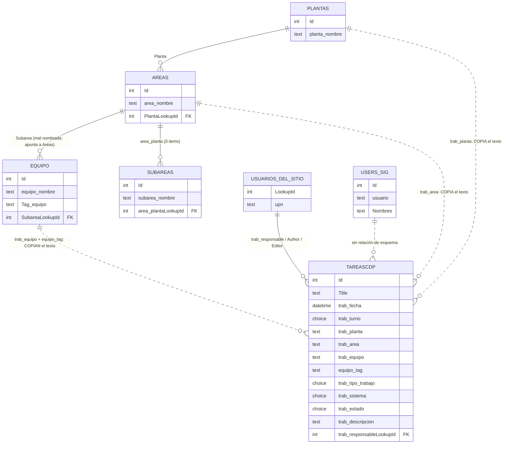

# MER del sitio de SharePoint `ControldeProcesosToquepala`

Levantado el 2026-11-05 con `data4cdpv1_local/scripts/sp_explorar_listas.py` (solo lectura, vía
Microsoft Graph). La lista principal es **`TareasCdP`** (nombre interno `SIGCDP`), la que llena el
formulario de Power Apps y a la que apuntaría el sincronizador de `TaskP`.

## 1. Inventario de las listas que participan

| Lista (display) | Interna | Items | Columnas propias | Rol |
|---|---|---:|---|---|
| **TareasCdP** | `SIGCDP` | **3147** | `Title`, `trab_fecha`, `trab_turno`, `trab_planta`, `trab_area`, `trab_equipo`, `equipo_tag`, `trab_hdw_sfw`, `trab_tipo_trabajo`, `trab_descripcion`, `trab_responsable`, `trab_estado`, `trab_sistema` | hecho: el reporte de trabajo |
| Plantas | `Plantas` | 5 | `planta_nombre` | maestra |
| Areas | `Areas` | 40 | `area_nombre`, `Planta` (lookup) | maestra |
| Equipo | `Equipo` | 467 | `equipo_nombre`, `Tag_equipo`, `Subarea` (lookup) | maestra |
| Users-sig | `Userssig` | 9 | `usuario`, `Nombres`, `DateBirthday`, contraseña | maestra de personas (propia, no AAD) |
| SubAreas | `SubAreas` | **0** | `subarea_nombre`, `area_planta` (lookup) | nivel creado y nunca usado |
| ListaEquipos | `ListaEquipo` | **0** | solo `Title` | vacía |
| Sistema | `Sistema` | **0** | solo `Title` | vacía: el vocabulario vive en la columna `choice` |
| Tipo de Trabajo | `Tipo de Trabajo` | **0** | solo `Title` | vacía: idem |

Otras listas del sitio no tocan a `TareasCdP`: `Inspecciones`, `Solicitud_Bypass`, `Bys passs`,
`Sha Bys passs`, `SSGG_Equipos`, `SSGG_Tareas`, `Birthday CdP`, `adf_user`, `Documentos`.

## 2. El diagrama

Línea continua `||--o{` = lookup real de SharePoint (integridad referencial).
Línea punteada `||..o{` = dependencia **de hecho**: la columna guarda texto copiado, nada impide
escribir un valor que no exista en la maestra.

## 3. Las tres clases de relación, y por qué importan

**Duras (lookup).** Solo tres, y ninguna sale de `TareasCdP`:
`Areas.Planta → Plantas.planta_nombre`, `SubAreas.area_planta → Areas.area_nombre`,
`Equipo.Subarea → Areas.area_nombre`. La columna de `Equipo` se llama `Subarea` pero apunta a
`Areas`: el nivel de subárea quedó sin usar (0 items), así que la jerarquía real es
**Planta → Área → Equipo**, de tres niveles, no de cuatro.

**Por persona.** `trab_responsable`, `Author` y `Editor` son `personOrGroup` contra los usuarios del
sitio. `Users-sig` es una maestra de personas *paralela* (9 filas, con usuario y contraseña en texto
plano en la lista) que **no** está vinculada a nada por esquema; la usa el Power App por su cuenta.

**Blandas (choice / texto).** `TareasCdP` **no tiene una sola columna lookup de negocio**: es una
tabla plana y desnormalizada. Planta, área y equipo se guardan como texto, y las columnas `choice`
están mal configuradas — sus valores declarados son los de fábrica:

| Columna | Valores declarados | Lo que realmente contiene |
|---|---|---|
| `trab_planta` | `['Opción 1']` | las 5 plantas, en mayúsculas |
| `trab_area` | `['1']` | 40 áreas |
| `trab_equipo` | `['2']` | 201 equipos |
| `trab_turno` | `['A','B']` | A (1527), B (1620) |
| `trab_tipo_trabajo` | PREVENTIVO / CORRECTIVO / SOPORTE / IMPLEMENTACIÓN | los 4 |
| `trab_estado` | COMPLETADO / PENDIENTE | COMPLETADO 2876, PENDIENTE 252, vacío 19 |
| `trab_sistema` | 8 valores | los 8, con ANALIZADORES 1597 y SYSTEM 800 ABB 925 |

Que estén mal configuradas es lo que permite que el formulario escriba texto libre, y es también lo
que permitiría al sincronizador escribir cualquier cosa sin que SharePoint se queje.

## 4. Integridad medida sobre las 3147 filas

A pesar de no haber integridad referencial, **el Power App la respeta casi perfecto**:

| Columna | Valores distintos | Fuera de la maestra |
|---|---:|---|
| `trab_planta` | 6 | 1 valor, 2 filas (`Opción 1`, el default de la choice) |
| `trab_area` | 40 | 1 valor, 25 filas (`1`, el default) |
| `trab_equipo` | 201 | 1 valor, 242 filas (`2`, el default) |

O sea: lo único que se sale de la maestra es el valor de fábrica de la columna, cuando el formulario
se guardó sin elegir. Todo lo demás coincide **exacto** con `Plantas`, `Areas` y `Equipo`.
`trab_responsable` está lleno en **3147 de 3147** filas.

La consecuencia para el sincronizador es directa: tiene que escribir los nombres de las maestras
tal cual, en mayúsculas, o sus filas serán las únicas rotas de la lista.

## 5. Dónde encaja `TaskP`

| Lado de la base | Filas | Lado de SharePoint | Filas |
|---|---:|---|---:|
| `works4cdp_plant` | 5 | `Plantas` | 5 |
| `works4cdp_area` | 33 | `Areas` | 40 |
| `works4cdp_equipment` | 209 (53 con tag) | `Equipo` | 467 (11 con `Tag_equipo`) |
| `works4cdp_system` | 11 | choice `trab_sistema` | 8 |

Las dos jerarquías tienen la misma forma (Planta → Área → Equipo) pero distinto vocabulario, así que
el sincronizador necesita una tabla de traducción en los tres niveles. No hay nada que reconciliar a
nivel de esquema: `TareasCdP` es plana y acepta texto.
